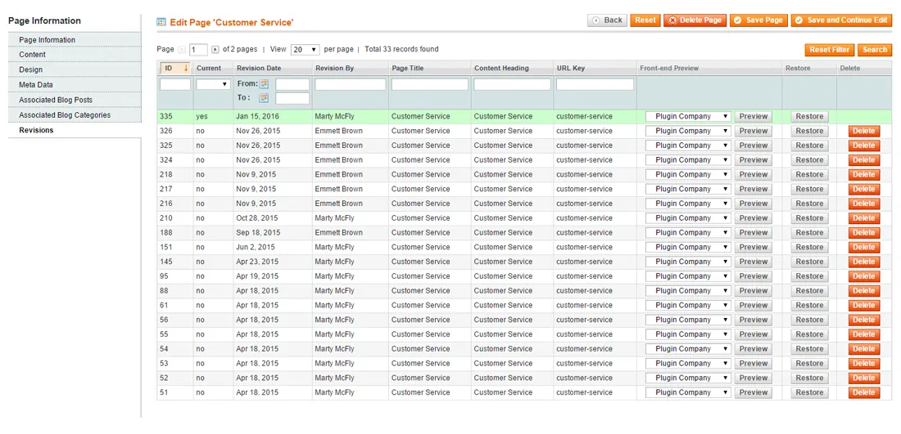
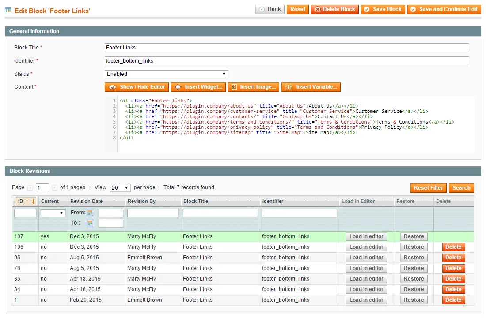

# CMS Revisions for Magento 1 / OpenMage

**Version control for Magento CMS pages and blocks.**



Saves a revision of a CMS page or block every time it is saved.

Preview, edit and restore earlier revisions from the admin, and see who changed what and when.

> [!NOTE]
> CMS Revisions is free and open source under the MIT License (since 2026). Plugin Company no longer actively develops this extension, but issues and pull requests are welcome.

## Features

- Automatic revision of CMS pages and blocks on every save
- Unlimited revisions per page or block
- Restore a revision with one click
- Preview page revisions in the storefront
- Edit block revisions in the content editor
- Shows who made each revision and when
- Recover accidentally deleted or overwritten content
- Works together with the Syntax Highlighter extension

## Screenshots

<table>
  <tr>
    <td width="50%" valign="top"><br><sub>CMS block revisions</sub></td>
    <td width="50%"></td>
  </tr>
</table>

## Compatibility

- **Magento:** Community Edition 1.4.x – 1.9.x, Enterprise Edition 1.8.x – 1.14.x
- **Latest version:** 1.1.1 (released 2019-04-08)
- **Composer package:** `plugincompany/magento1-cms-revisions`
- **Module:** `Plugincompany_Cmsrevisions`

## Installation

### modman

```bash
cd /path/to/magento
modman init   # once per Magento installation
modman clone https://github.com/PluginCompany/magento1-cms-revisions.git
```

modman creates symlinks, so enable *Allow Symlinks* under System > Configuration > Advanced > Developer > Template Settings.

### Composer

With [magento-hackathon/magento-composer-installer](https://github.com/Cotya/magento-composer-installer) (it reads the `modman` file of this repository):

```bash
composer config repositories.plugin.company composer https://plugin.company/
composer require plugincompany/magento1-cms-revisions
```

Your project `composer.json` needs the Magento root directory in its `extra` section (and, with Composer 2.2+, the installer plugin allowed), for example:

```json
{
    "extra": { "magento-root-dir": "./" },
    "config": { "allow-plugins": { "magento-hackathon/magento-composer-installer": true } }
}
```

### Manual installation

Download the ZIP of the latest release from the [tags page](https://github.com/PluginCompany/magento1-cms-revisions/tags) ([1.1.1](https://github.com/PluginCompany/magento1-cms-revisions/archive/refs/tags/1.1.1.zip)) and copy the `app/`, `js/` folders into your Magento root:

```bash
unzip magento1-cms-revisions-1.1.1.zip
cp -R magento1-cms-revisions-1.1.1/app magento1-cms-revisions-1.1.1/js /path/to/magento/
```

Step-by-step instructions are in the [installation guide](docs/02-installing-the-extension.md).

### After installing

Clear the cache (System > Cache Management, or `rm -rf var/cache/*`), then log out of the admin and log in again so the new configuration sections and permissions are loaded.

### Upgrading from a purchased copy

Replace the old files with this release. No license key is needed; your settings and data stay as they are.

## Documentation

- [Documentation in this repository](docs/README.md) (Installation Guide, User Manual)
- Online documentation: <https://plugin.company/knowledge-base/docs/magento-cms-revisions/>
- Product page: <https://plugin.company/magento1-extensions/cms-revisions.html>
- Magento 2 version: [magento2-cms-revisions](https://github.com/PluginCompany/magento2-cms-revisions)

## Changelog

See [CHANGELOG.md](CHANGELOG.md) for the release history.

## Contributing

Found a bug or have an improvement? Please open an [issue](https://github.com/PluginCompany/magento1-cms-revisions/issues) or send a [pull request](https://github.com/PluginCompany/magento1-cms-revisions/pulls). Since the extension is no longer actively developed by Plugin Company, fixes from the community are the best way to keep it working on current Magento 1 / OpenMage and PHP versions.

## License

Plugin Company's code in this repository is released under the [MIT License](LICENSE), Copyright (c) 2014-2026 Plugin Company.

No third-party libraries are bundled; see [THIRD-PARTY-NOTICES.md](THIRD-PARTY-NOTICES.md).
