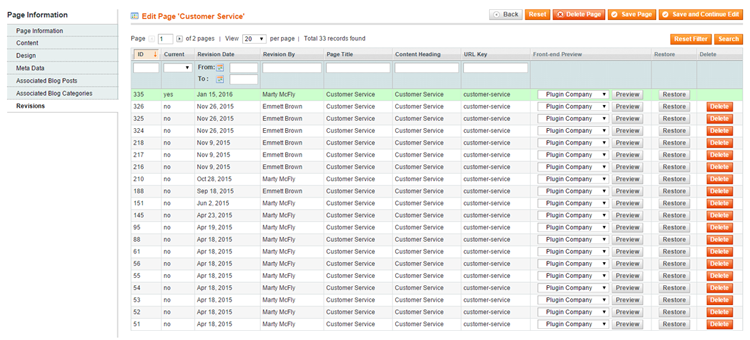
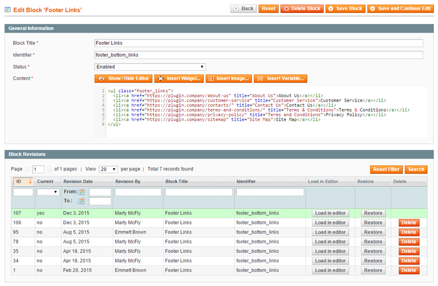

# Using the CMS Revisions Extension

After installing Magento CMS Revisions, the extension will automatically create a backup each time a CMS page or block is saved, enabling you to easily manage, preview and restore the CMS revisions in the Admin Panel.

## Managing CMS Page Revisions

To manage CMS page revisions, navigate to **CMS > Pages** in the top Admin Panel menu, select a page from the grid and click **Revisions** in the Page Information menu.

The Revisions tab shows an overview of all saved page revisions with the current version highlighted in green.

CMS page revisions can be sorted and filtered by revision date, admin user, page title, content heading and URL key.

You can preview each page revision in the front-end store by selecting a store from the dropdown menu (if applicable) and clicking the 'Preview' button.

Click the 'Restore' button to directly recover CMS page revisions.

Click the 'Delete' button to permanently remove page revisions from the back-end Revisions tab.

## Managing CMS Block Revisions

To manage CMS block revisions, navigate to **CMS > Static Blocks** in the top Admin Panel menu, select a block from the grid and scroll down to **Block Revisions**.

The Block Revisions section shows an overview of all saved block revisions with the current version highlighted in green.

CMS block revisions can be sorted and filtered by revision date, admin user, block title and identifier.

You can directly load and modify each block revision in the content editor by clicking the 'Load in editor' button.

Click the 'Restore' button to directly recover CMS block revisions.

Click the 'Delete' button to permanently remove block revisions from the Block Revisions section.

---

[Documentation index](./README.md) · [README](../README.md) · [Online version](https://plugin.company/knowledge-base/docs/magento-cms-revisions/user-manual/using-the-cms-revisions-extension/)
